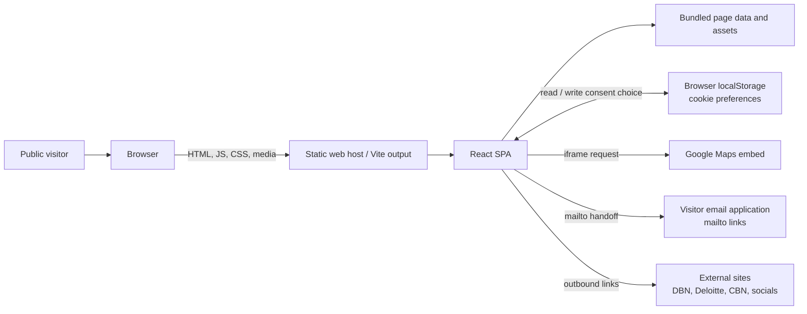
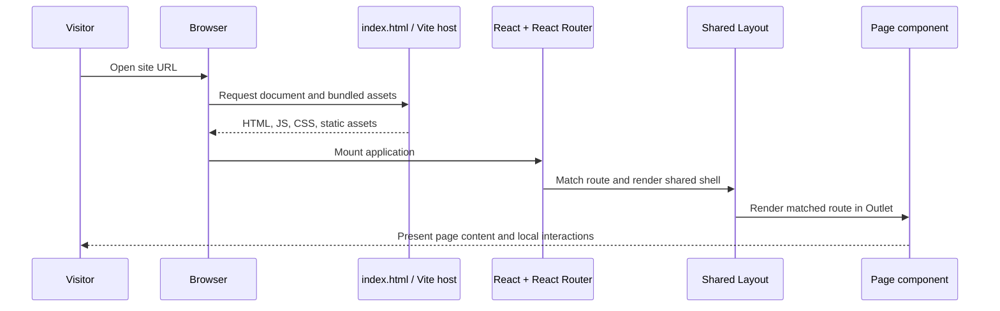
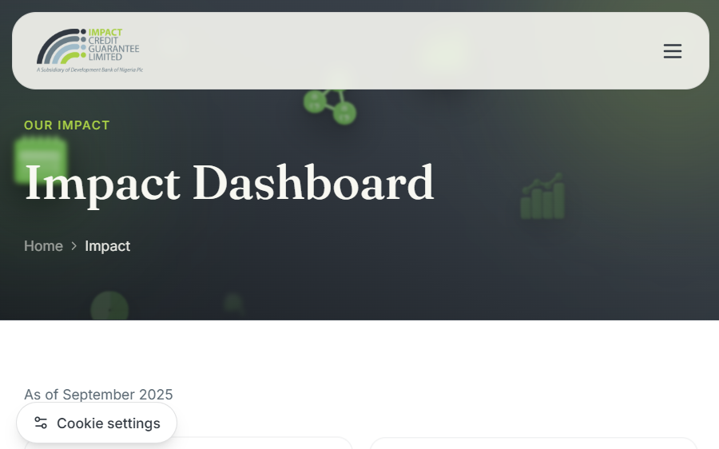
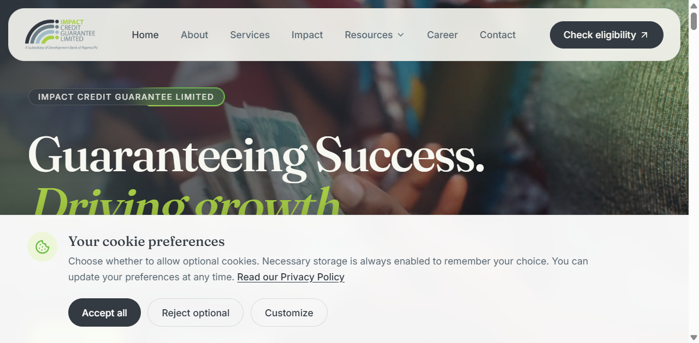

# System Architecture

**Baseline:** 28 September 2026  
**System type:** Client-rendered, static single-page application (SPA)

## 1. Purpose and scope

The ICGL website presents the organisation, its guarantee services, eligibility information, impact, news, publications, policies, ratings, careers, contact information, and complaint/whistleblowing channels. It is a public information and marketing website. The repository contains no application server, database, user accounts, or private operational portal.

## 2. Context diagram



The static host serves the built files. React Router handles client-side navigation. A production host must provide SPA fallback/rewrite behavior so direct requests to routes such as `/resources/news` return the app entry point.

## 3. Runtime and build components

| Layer | Implementation | Responsibility |
|---|---|---|
| Document shell | `index.html` | Root mount point, viewport, title and description metadata |
| Bootstrap | `src/main.jsx` | React root, strict mode, global stylesheet, application mount |
| Routing | `src/App.jsx` | BrowserRouter route table and shared layout boundary |
| Shared shell | `src/components/layout/Layout.jsx` | Navbar, main route outlet, footer, route-scroll reset, cookie preferences |
| Navigation | `src/components/layout/Navbar.jsx` | Desktop/mobile navigation, Resources submenu, eligibility CTA |
| Shared UI | `src/components/`, `src/components/motion/` | Page hero, cards, counters, image/reveal and staggered motion primitives |
| Pages | `src/pages/` | Home, About, Services, Impact, Eligibility, Careers, Contact and team bio |
| Resource pages | `src/pages/resources/` | News, FAQs, Ratings, Publications, Policies, Privacy, Whistleblowing, Complaints |
| Local data | `src/data/content.js`, `src/data/pfiLogos.js` | Navigation, contact details, impact values, services, news and shared content |
| Static assets | `src/assets/`, `public/` | Images, icons, videos and policy PDFs |
| Styling/build | Tailwind CSS 4, Vite 5 | Utility styling, asset processing and production bundling |

### High-level request and rendering flow



## 4. Route catalogue

All listed pages use the shared `Layout` route unless otherwise noted. The route table is defined in `src/App.jsx`.

| Route | Page/component | Main purpose |
|---|---|---|
| `/` | `Home` | Organisation identity, values, impact, PFI support CTA and news |
| `/about` | `About` | Organisation profile, governance and leadership |
| `/about/:group/:slug` | `TeamMemberBio` | Individual board or management profile |
| `/services` | `Services` | Guarantee and support offerings |
| `/impact` | `Impact` | Impact metrics, stories and dashboard |
| `/eligibility` | `Eligibility` | PFI eligibility criteria and information |
| `/career` | `Career` | Career information, opportunities and testimonial carousel |
| `/career/:slug` | `JobDescription` | Role details and application/contact information |
| `/contact` | `Contact` | Office contact details, message form and map embed |
| `/resources/news` | `News` | Local news list with keyword, year and category filters |
| `/resources/faqs` | `Faqs` | Frequently asked questions |
| `/resources/ratings` | `Ratings` | Ratings and certification information |
| `/resources/publications` | `Publications` | Local publication catalogue with filters |
| `/resources/policies` | `Policies` | Policy summaries and PDF links |
| `/resources/privacy-policy` | `PrivacyPolicy` | Privacy information including cookies |
| `/resources/whistleblowing` | `Whistleblowing` | Speak-up information and external channels |
| `/resources/complaints` | `Complaints` | Complaint process, categories and mailto form |
| Any unmatched route | `NotFound` | Not-found page |

## 5. Data and state ownership

### Content

- Most shared text, navigation, contact details, impact values, services, FAQs and news entries are source-controlled JavaScript data. There is no CMS or content API.
- Publication cards are a local in-component array in `src/pages/resources/Publications.jsx`.
- Images and policy documents are bundled or served as static assets. Vite assigns production asset names and copies imported assets into `dist/assets/`.

### Browser state

| State | Owner | Persistence |
|---|---|---|
| Mobile menu, filters, FAQ panels, carousels, contact confirmation | React page/component state | In-memory; resets on reload |
| Cookie preference object | `CookieConsent` | `localStorage`, key `icgl-cookie-preferences-v1` |
| Route and URL fragment | React Router/browser | Browser URL/history |

Cookie preference shape:

```json
{
  "necessary": true,
  "analytics": false,
  "marketing": false
}
```

Necessary is required to be `true`. This implementation records consent preferences only. No analytics or marketing scripts are configured in this repository, so those categories do not currently gate third-party tracking code.

## 6. Integrations and trust boundaries

| Integration | Usage | Boundary / operational behavior |
|---|---|---|
| Google Maps | Embedded iframe on Contact page | Requires visitor network access and Google's map service; verify map pin and privacy disclosure |
| Email application | `mailto:` links, including complaints form | Opens the visitor's configured mail application; does not provide server-side submission or delivery receipt |
| External organisations and social platforms | Outbound links | External availability/content is outside this SPA's control |
| Local storage | Cookie preference choice | Browser-local and origin-specific; unavailable/private-mode storage errors are surfaced in the consent UI |

There is no application API, database, authentication, payment processing, or server-side form handler in the current repository.

## 7. Styling, motion, and accessibility considerations

- Tailwind CSS utility classes and shared theme tokens in `src/index.css` define responsive layout and brand colors.
- Framer Motion powers reveal, carousel, hover, and transition effects. Some interactive motion responds to the reduced-motion preference; check each component during accessibility review rather than assuming a global motion policy.
- Semantic landmarks, headings, form labels, image alternative text, and accessible button names are used in many key surfaces. A complete WCAG audit has not been run.
- News/publications filter controls include labels for screen readers and expose a result count and empty state.
- Consent controls use native checkboxes and buttons; keyboard-only navigation and screen-reader behavior remain formal UAT/QA work.

## 8. Security and privacy design notes

- This is a public client-side site; all bundled source and assets should be treated as publicly readable.
- Do not place credentials, private data, or server-only configuration in client code or public assets.
- The consent record is not evidence of server-side consent collection or proof that optional cookies are blocked; that requires integration and network verification before tracking tools are introduced.
- Form interfaces must not be described as server-submitted unless an approved backend is implemented and tested.
- The policy page currently reuses the Anti-Bribery & Corruption PDF for its Whistleblowing card. Confirm with the policy owner that the shared file is intended; otherwise replace it with the approved Whistleblowing document.

## 9. Architecture images

### Home page


### Impact page



### Cookie preference prompt


