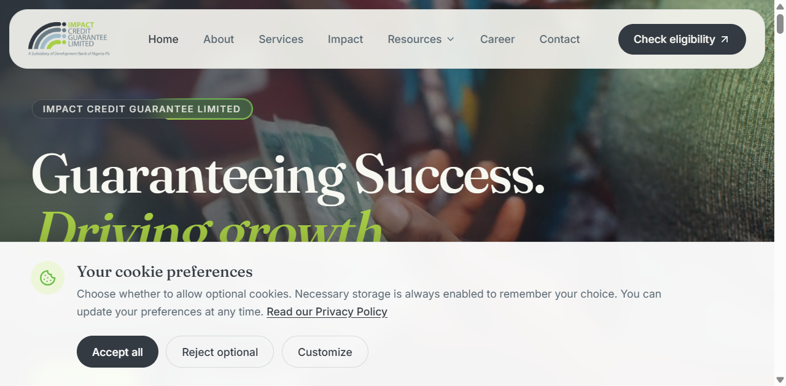
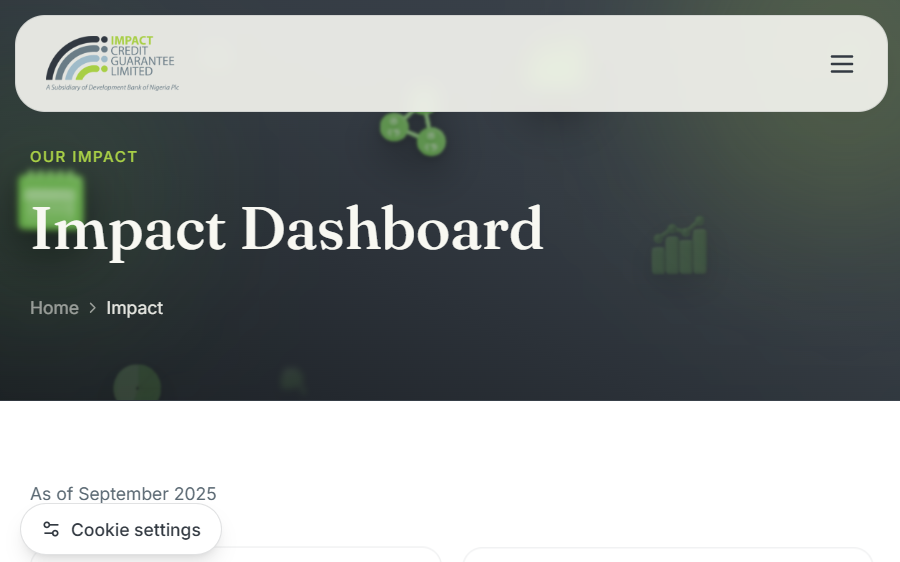
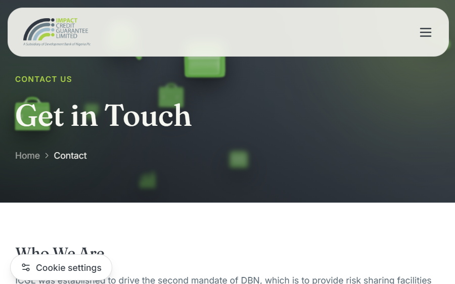
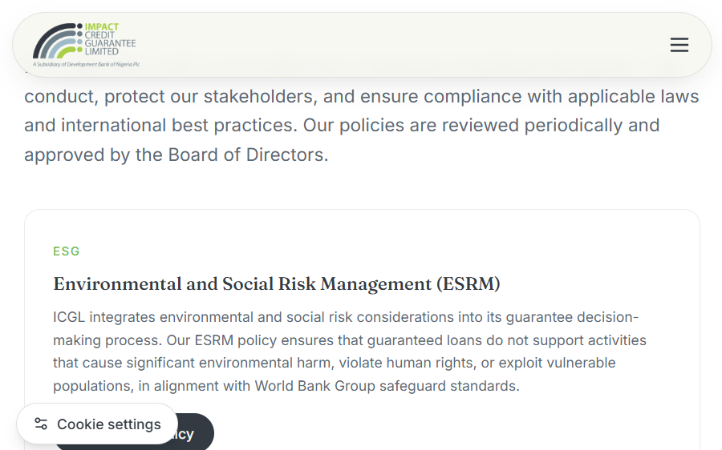
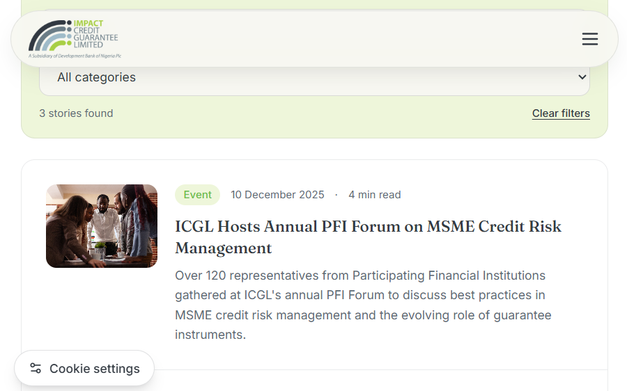
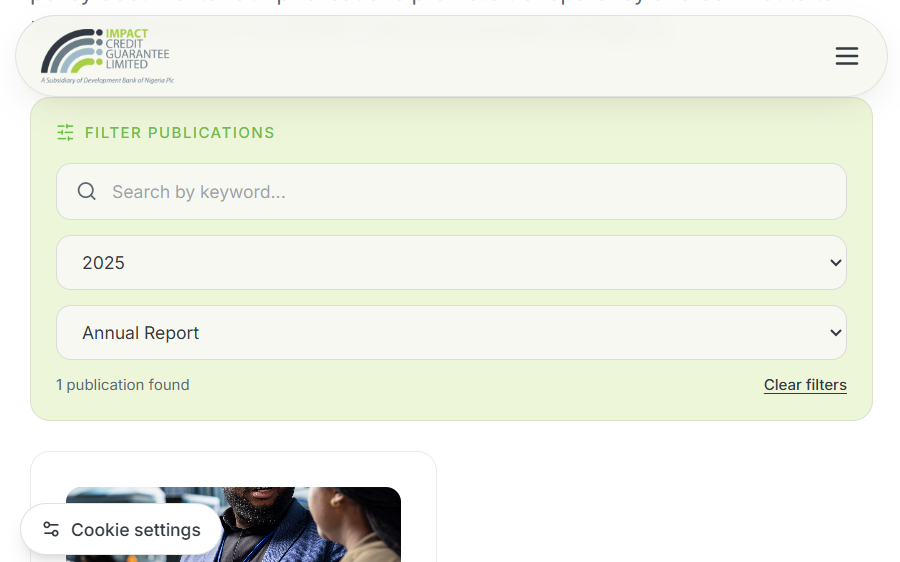

# Test Evidence and Local Smoke Report

**Execution date:** 28 September 2026  
**Environment:** Local Vite development server (`http://127.0.0.1:5173`) and Windows workspace  
**Scope:** Build, route render smoke, selected filters, policy link rendering, visual screenshots  
**This is not:** Full UAT, production verification, a cross-browser matrix, or an accessibility certification.

## 1. Summary

| Check | Result | Recorded observation |
|---|---|---|
| `npm run build` | **Passed** | Vite 5.4.21 created production output in `dist/`; build completed successfully |
| Static diagnostics | **Passed (scoped)** | No errors reported for `CookieConsent.jsx` and `Layout.jsx` after their changes |
| Route smoke | **Passed: 15/15** | Every sampled route rendered the expected page heading |
| News keyword sample | **Passed** | Keyword `MSME` returned 3 stories and exposed Clear filters |
| Publications filter sample | **Passed** | Year `2025` + category `Annual Report` returned 1 publication and exposed Clear filters |
| Policies actions | **Partial** | Five “Read … policy” links render; Whistleblowing currently maps to the Anti-Bribery PDF |
| Cookie prompt | **Visually observed** | First-visit prompt and preferences UI captured; interactive category persistence requires a formal follow-up test |
| Automated unit/e2e test suite | **Not available** | No test framework or test script is configured |

The production build emitted Vite's advisory that a minified JavaScript chunk exceeds 500 kB. This is a performance follow-up, not a build failure.

## 2. Route smoke details

| Path | Expected heading observed | Result |
|---|---|---|
| `/` | Guaranteeing Success. Driving growth. | Pass |
| `/about` | Who We Are | Pass |
| `/services` | What We Do | Pass |
| `/impact` | Impact Dashboard | Pass |
| `/eligibility` | Eligibility for ICGL Guarantee Support | Pass |
| `/career` | Unlock Your Potential | Pass |
| `/contact` | Get in Touch | Pass |
| `/resources/news` | News & Updates | Pass |
| `/resources/faqs` | FAQs | Pass |
| `/resources/ratings` | Our Ratings & Certifications | Pass |
| `/resources/publications` | Reports & Publications | Pass |
| `/resources/policies` | Our Corporate Policies | Pass |
| `/resources/privacy-policy` | Privacy Policy | Pass |
| `/resources/whistleblowing` | Speak Up. Your Voice Matters. | Pass |
| `/resources/complaints` | We're Here to Help | Pass |

`/about/:group/:slug` and `/career/:slug` are parameterized routes; this smoke pass did not exercise a specific real profile or job slug.

## 3. Feature observations

### Filters

- News search input filled with `MSME`: result summary changed to **3 stories found**.
- Publications filters set to `2025` and `Annual Report`: summary changed to **1 publication found**.
- These checks confirm a sample path only; combinations, reset behavior, empty results, casing, and accessibility still belong in regression/UAT.

### Cookie consent

- The clean local browser showed the first-visit consent panel.
- Choosing “Reject optional” closed the panel and displayed the “Cookie settings” control; reopening showed the preference panel.
- A complete accept-all/custom-category persistence matrix was not recorded as passed. See [QA-004](./quality-assurance.md#5-regression-suite) and UAT-01/UAT-02.

### Policy links

- The policy page displayed five “Read … policy” actions.
- ESRM, IMS, Privacy and Anti-Bribery actions import their corresponding local PDFs.
- The Whistleblowing card currently imports the same Anti-Bribery PDF. No standalone Whistleblowing PDF was present in `src/assets/files/` during this baseline; confirm with the policy owner that the shared document is intended or map the correct approved file.

## 4. Screenshots

Screenshots were captured from the local browser run. They document appearance and selected states, not all responsive sizes.

### Home and first-visit consent

### Impact and contact

### Policies and content filters

## 5. Browser/runtime notes

- The local browser logged React Router v6 future-flag warnings. They did not prevent the tested pages from rendering.
- The Contacts page includes a Google Maps iframe, which depends on external service/network availability.
- Screenshots were produced by the local browser capture environment; confirm the same assets, map, links, and visual treatment on staging.

## 6. Follow-up evidence required

1. Run `npm ci` and `npm run build` from a clean checkout/CI runner.
2. Run the completed regression suite once automated tests exist.
3. Verify direct navigation and SPA fallback on the actual hosting platform.
4. Execute all P0 UAT cases, including full cookie categories/reload, form handoffs, document downloads, responsive and keyboard/screen-reader flows.
5. Repeat policy/document checks after the policy owner confirms whether the shared PDF mapping is correct.
